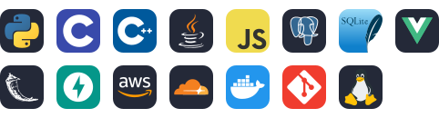

<h1 align="center">Hi, I'm Aniruddha 👋</h1>

  

  
  
  

---

### About me

- 🎓 Year 2, B.Comp. Computer Engineering at **Nanyang Technological University** (Class of 2029)
- ☁️ I like shipping full-stack apps on serverless infrastructure: **Cloudflare Workers / Pages / D1** and **AWS Lambda / API Gateway / DynamoDB**
- 🚀 Currently building a product of my own, more soon
- 📜 HarvardX **CS50x** · **CS50AI** · **Technology Entrepreneurship** · AWS Certified Cloud Practitioner *(in progress)*

### Tech stack

  

### Featured projects

| Project | What it does | Built with |
|---|---|---|
| **RSPeak** | Volunteer management platform that automates volunteer and student attendance for a tutoring centre, saving ~2 hours of admin every week | Vue.js · Cloudflare Workers · Pages · D1 |
| **TeleAuth** | Zero-cost one-time-password authentication delivered through a Telegram bot, replacing paid SMS OTP | Python · AWS Lambda · API Gateway · DynamoDB |

### Competitions

| Result | Event |
|---|---|
| 🥈 2nd Place | Google Datacenter Hackathon 2026 (server assembly + Capture The Flag) |
| 🏅 Honourable Mention, Top 13 / 117 | NTU SCDS TechFest 2026 Hackathon |
| 🥈 2nd Place Globally | International Rescue Committee Open Innovation Challenge 2025 |
| 🥉 3rd Place | Temasek Youth Challenge 2025 |

---

<i>Always happy to chat about startups, serverless architecture or a game of chess ♟️</i>

